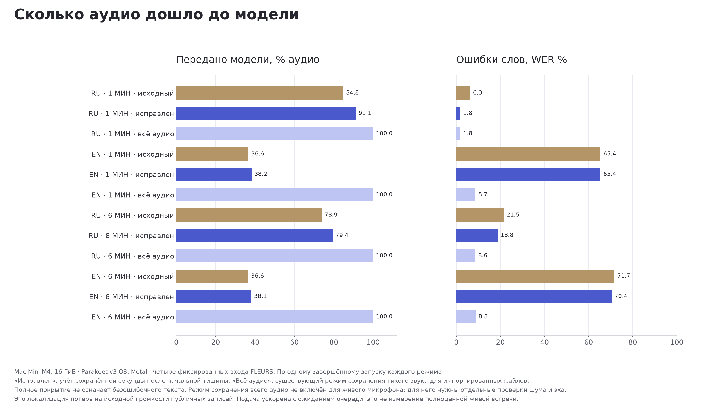
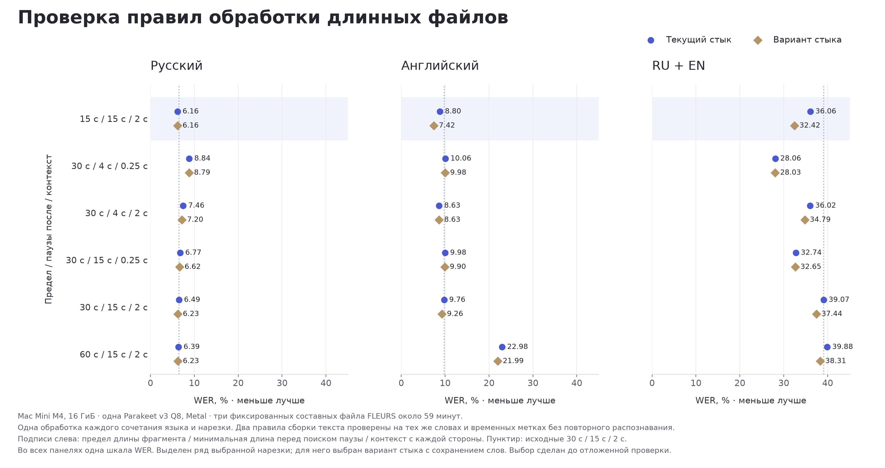
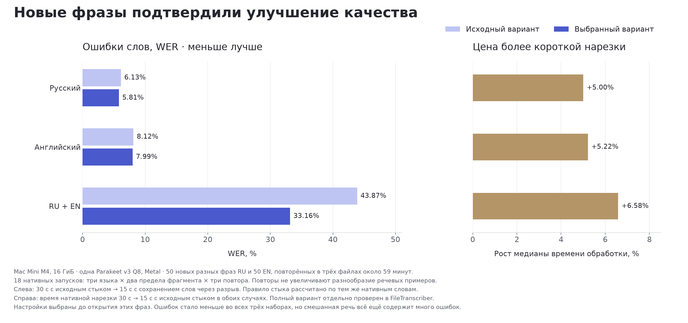
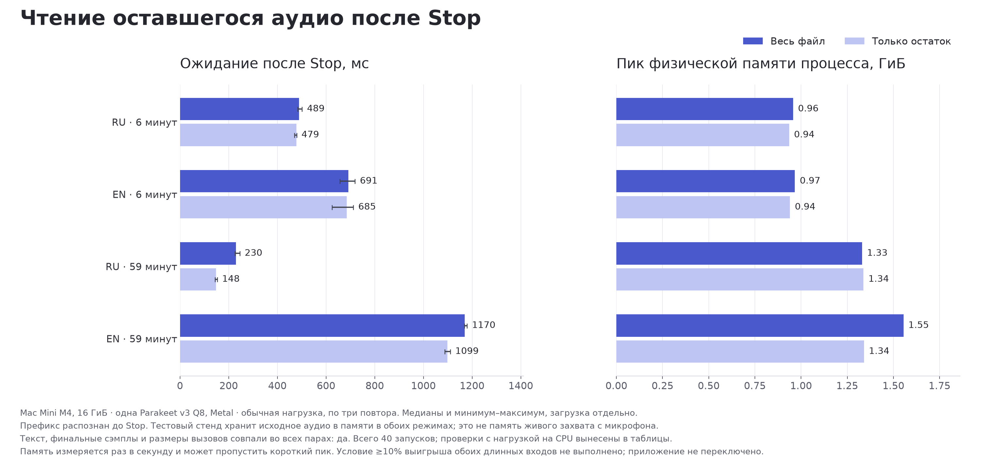
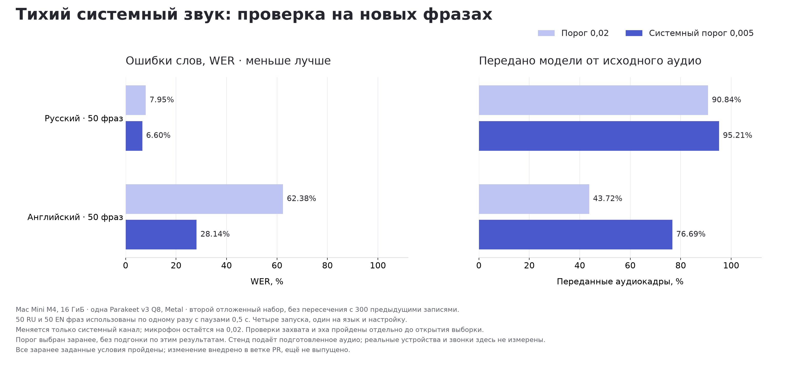

# OpenRamble: проверка гипотез

Измерения Mac Mini M4, 10 CPU, 16 ГиБ, macOS 26.4. Parakeet v3 Q8,
Metal, transcribe.cpp 0.2.3. Основные результаты и сравнения на другом
компьютере находятся в [RESULTS.md](README.md).

Решение об изменении приложения требует всей цепочки: наблюдение, заранее
заданный критерий, проверка на новых фразах, воспроизводящий тест и проверка
исправления. Поисковые результаты сами по себе не меняют настройки.

## Параллельные модели: условие устойчивости не выполнено

Полная исходная серия содержит 21 успешный запуск. Две модели ускоряли
обработку длинных файлов примерно на 12–14%, сохраняя точный текст и временные
метки. При этом одна попытка с двумя моделями остановлена по памяти.

В отдельной серии после освобождения ресурсов завершились ещё 17 запусков.
Три результата с четырьмя моделями имеют по одному повтору на язык. Две попытки
остановлены по памяти, четыре из-за начала посторонней сборки; семь оставшихся
проверок отменены после провала условия устойчивости. Успешные повторные
запуски не отменяют сбоев. По умолчанию остаётся одна модель.

[Основная серия](data/summary.json), [дополнительная серия](data/scaling/summary.json)

## Встречи: исправлен отсчёт после начальной тишины

Код сохранял секунду звука, но начинал относительный счётчик заново. Поэтому
следующая граница могла оказаться внутри речи. Новый тест упал на старом
коде: граница 261600 кадров вместо допустимых 272000 или позже. Исправление
согласовало счётчик с оставшимся звуком, не меняя порог громкости.

| Вход | WER до | WER после | WER при сохранении всего аудио |
| --- | --- | --- | --- |
| ru-60s | 6.31% | 1.80% | 1.80% |
| en-60s | 65.35% | 65.35% | 8.66% |
| ru-360s | 21.49% | 18.78% | 8.63% |
| en-360s | 71.70% | 70.43% | 8.76% |

Восемь завершённых проверок до и восемь после. Контроли с сохранением всего
аудио дали совершенно одинаковый текст и сегменты в обеих сборках. Это
поддерживает узкое исправление координат; тихая английская речь продолжает
отсекаться до модели. Эти серии не используются для сравнения скорости.

[Сравнение и проверка совпадения](data/meeting-after/offset-comparison.json)

## Длинные файлы: 12 вариантов качества

18 нативных запусков охватывают три языка и шесть способов разбиения.
Два правила сборки текста применены к одним и тем же распознанным словам.
Исходное правило в повторном расчёте точно воспроизвело нативные слова и
временные метки во всех 18 случаях. Три исходных контроля также совпали с
полной базовой серией.

Вариант стыка сохраняет прежнее совпадение по двум словам. Если совпадения нет,
но первый новый фрагмент начинается хотя бы через 0,6 секунды после последнего
старого слова, оба текста сохраняются. В остальных случаях применяется прежняя
граница по середине слова. Порог взят из существующего допуска времени,
а не подобран перебором.

| Предел / паузы после / контекст | Стык | RU WER | EN WER | RU+EN WER | Условие пройдено |
| --- | --- | --- | --- | --- | --- |
| 15 с / 15 с / 2 с | исходный | 6.16% | 8.80% | 36.06% | да |
| 15 с / 15 с / 2 с | с сохранением | 6.16% | 7.42% | 32.42% | да |
| 30 с / 4 с / 0.25 с | исходный | 8.84% | 10.06% | 28.06% | нет |
| 30 с / 4 с / 0.25 с | с сохранением | 8.79% | 9.98% | 28.03% | нет |
| 30 с / 4 с / 2 с | исходный | 7.46% | 8.63% | 36.02% | нет |
| 30 с / 4 с / 2 с | с сохранением | 7.20% | 8.63% | 34.79% | нет |
| 30 с / 15 с / 0.25 с | исходный | 6.77% | 9.98% | 32.74% | да |
| 30 с / 15 с / 0.25 с | с сохранением | 6.62% | 9.90% | 32.65% | да |
| 30 с / 15 с / 2 с | исходный | 6.49% | 9.76% | 39.07% | нет |
| 30 с / 15 с / 2 с | с сохранением | 6.23% | 9.26% | 37.44% | нет |
| 60 с / 15 с / 2 с | исходный | 6.39% | 22.98% | 39.88% | нет |
| 60 с / 15 с / 2 с | с сохранением | 6.23% | 21.99% | 38.31% | нет |

Условие: смешанный WER ниже хотя бы на 2 процентных пункта; русский и
английский WER и доля пропусков не ухудшаются больше чем на 0,5 пункта.
Выбор среди прошедших вариантов: смешанный WER, затем суммарный WER двух
языков, затем число изменённых настроек и заданный порядок разрешения равенств.

Самый низкий смешанный WER получился с ранними паузами и коротким контекстом,
но русский ухудшился. Этот вариант отклонён. Выбран предел 15 секунд,
минимум 15 секунд перед поиском паузы, контекст 2 секунды и сохранение на стыке.
Ранние паузы действительно изменили число фрагментов: например, RU 205 → 425,
смешанный файл 206 → 303. Это проверенное изменение входов, а не только параметра.

[Все оценки и выбор](data/file-quality/development-decision.json),
[границы фрагментов](data/file-quality/cut-geometry.json),
[отсутствие пересечений по аудиосэмплам](data/file-quality/audio-disjointness.json),
[зафиксированный план отложенной проверки](data/file-quality/heldout-registration.json)

### Проверка на отложенных фразах

| Язык | Исходный WER | Выбранный WER | Изменение, п.п. | Время до / после, с |
| --- | --- | --- | --- | --- |
| RU | 6.13% | 5.81% | -0.32 | 98.27 / 103.19 |
| EN | 8.12% | 7.99% | -0.14 | 97.22 / 102.29 |
| MIXED | 43.87% | 33.16% | -10.72 | 92.99 / 99.11 |

Условие отложенной проверки: пройдено. 50 разных фраз каждого языка не пересекаются с поисковой выборкой по записи, нормализованной фразе и хешу аудио. Они повторены в длинных составных файлах. Три вычислительных повтора на ячейку проверяют устойчивость текста и времени; они не увеличивают число разных речевых примеров. Время относится к нативной нарезке с исходным соединением; качество варианта стыка получено повторным расчётом по тем же словам. Полный нативный вариант проверяется отдельно. Качество не означает ускорение. Внедрение зависит также от нативного воспроизведения и регрессионных проверок. [Данные решения](data/file-quality/heldout-decision.json)

Выбранный вариант внедрён в ветке PR: все 36 сохранённых результатов воспроизведены нативным соединением, три полных файла через FileTranscriber дали точный ожидаемый текст и временные метки. Тесты воспроизвели старое поведение до исправления и прошли после него. Проверки пакетов, жизненного цикла, Rust, FFI и общих правил прошли; известные модельные E2E-ошибки ниже остаются. Это ещё не выпущенная версия. [Проверка полного пути](data/file-quality/native-verification.json), [регрессионные проверки](data/file-quality/regression-evidence.json), [остальные проверки](data/file-quality/check-evidence.json)

## Конец короткой фразы: добавление тишины не помогло

Исходная синтетическая фраза Samantha и та же фраза с 500 мс нулевого звука
дали одинаковый ошибочный текст. В обоих случаях был один вызов модели и ни
одного разбиения: ошибка не возникла при соединении потоковых фрагментов.
Это отрицательный результат для одного заранее выбранного способа исправления,
а не доказательство отсутствия любых проблем на концах фраз. Настройки не меняются.

[Оба результата и решение](data/tts-end-context/decision.json)

## Чтение остатка записи после Stop

| Вход | Условие | n | Весь файл, мс | Остаток, мс | Выигрыш медианы |
| --- | --- | --- | --- | --- | --- |
| ru-360s | normal | 3 | 488.9 | 478.6 | +2.1% |
| ru-360s | cpu10 | 3 | 522.3 | 567.7 | -8.7% |
| en-360s | normal | 3 | 691.5 | 685.2 | +0.9% |
| en-360s | cpu10 | 3 | 709.2 | 728.1 | -2.7% |
| ru-3540s | normal | 3 | 230.0 | 148.0 | +35.7% |
| ru-3540s | cpu10 | 1 | 250.2 | 194.1 | +22.4% |
| en-3540s | normal | 3 | 1169.7 | 1098.6 | +6.1% |
| en-3540s | cpu10 | 1 | 1399.5 | 1269.8 | +9.3% |

Условие бенчмарка: не пройдено. Требуются точное совпадение текста, финальных сэмплов и размеров декодирования, отсутствие новых сбоев памяти и минимум 10% выигрыша медианы на обоих длинных входах при обычной нагрузке. Жизненный цикл и подключение приложения проверяются отдельно. Стенд держит исходное аудио в памяти в обоих вариантах; это не прямое измерение памяти живого микрофона. [Решение и пары](data/tail-read/decision.json)

Английский длинный вход дал 6,09% вместо требуемых 10%. Условие не изменено после просмотра результатов; приложение остаётся на прежнем чтении. На шестиминутных входах выигрыш около 1–2% при обычной нагрузке, а под CPU-нагрузкой вариант медленнее. Две попытки прерваны посторонней сборкой, предупреждений памяти в этой серии не было.

## Тихая речь, шум и эхо

Сохранение всего аудио отклонено: оба исходных теста эха стали выдавать микрофонную реплику. Для порога 0,005 прошли четыре непрерывных примера, но оба примера с редкими всплесками дали эхо. Те же редкие всплески при исходном пороге 0,02 прошли. Пиковая громкость пересекает новый порог речи, пока средняя энергия остаётся ниже порога включения защиты от эха. Временные исследовательские патчи сняты, настройка микрофона не изменена. [Восемь проверок и решение](data/quiet-meeting/echo-decision.json)

| Вход | WER, порог 0,02 | WER, порог 0,005 | Изменение, п.п. |
| --- | --- | --- | --- |
| ru-60s | 1.80% | 1.80% | +0.00 |
| en-60s | 65.35% | 48.82% | -16.54 |
| ru-360s | 18.78% | 6.09% | -12.69 |
| en-360s | 70.43% | 35.79% | -34.64 |

| Шум | Лишних слов, до / после | Вызовов, до / после | Работа модели, до / после, с |
| --- | --- | --- | --- |
| negative-silence | 0 / 0 | 0 / 0 | 0.000 / 0.000 |
| negative-uniform003 | 0 / 0 | 0 / 0 | 0.000 / 0.000 |
| negative-uniform010 | 0 / 0 | 0 / 2 | 0.000 / 0.285 |
| negative-sine50hz | 0 / 0 | 0 / 1 | 0.000 / 0.235 |
| negative-clicks1ms | 0 / 0 | 2 / 2 | 0.252 / 0.252 |

Условия нативной поисковой проверки: пройдены. Это один заранее выбранный порог, четыре речевых входа и пять синтетических шумов, без перебора параметров. Пустой правильный текст не означает отсутствия вычислительной работы. Проверки эха и следующей отложенной выборки требуются отдельно. Эти примеры не представляют все реальные встречи, комнаты и микрофоны. [Условия и результаты](data/quiet-meeting/decision.json)

### Дополнительная проверка гипотезы: только системный звук

После провала эха рассмотрен отдельный порог для звука собеседника с неизменным микрофоном. Условия записаны до просмотра нативной карты речи и шума. Все её условия прошли. Затем десять проверок настоящего захвата подтвердили новый системный порог, неизменный микрофон, сохранение явно переданных параметров и отсутствие микрофонного эха на непрерывных и редких всплесках. Два теста воспроизвели проблему до изменения; все 45 проверок захвата и эха прошли после него. Только после этого открыта вторая выборка: 50 новых RU и 50 EN фраз, без повторения фраз внутри файла. Нет пересечений с 300 предыдущими записями по нормализованному тексту и аудиосэмплам. Каждый файл обработан один раз каждой настройкой. Это проверка качества, не оценка разброса времени.

| Язык | WER до | WER после | Изменение, п.п. | Вызовы до / после |
| --- | --- | --- | --- | --- |
| RU | 7.95% | 6.60% | -1.34 | 42 / 43 |
| EN | 62.38% | 28.14% | -34.24 | 22 / 37 |

Все заранее заданные условия прошли; новый порог только системного звука внедрён в ветке PR. Сборка прошла 659 проверок ядра, 199 LocalASR с 32 пропусками и 188 Rust; известные модельные ошибки остаются ниже. Микрофон по-прежнему использует 0,02. Остаточный WER остаётся существенным; результаты не обещают такого же эффекта в каждой комнате, при всех кодеках звонка и одновременной речи. [Решение и все четыре запуска](data/system-heldout/decision.json), [эхо и регрессии](data/system-meeting/echo-decision.json), [проверка отсутствия пересечений](data/system-meeting/audio-disjointness.json), [регистрация до измерения](data/system-meeting/system-only-registration.json)

## Существующие неуспешные E2E-проверки

Исходная и текущая сборки воспроизвели три одинаковые проблемы: неточное
распознавание конца короткой английской фразы; обработка готового файла около
полуминуты дольше заданной секунды; три упоминания имени вместо четырёх в
синтетической смешанной записи. Это сохраняющиеся ограничения, а не зелёный
полный E2E-прогон. Порог теста готового файла не равен задержке потокового Stop.
Модель-независимые пакеты, Rust, FFI и conformance проверяются отдельно.

## Что не повторяем без нового основания

Нативные пакеты нескольких аудио, принудительный язык, произвольные короткие
окна диктовки и старые Core ML-кэши уже проверялись и не дали пригодного
решения. В обработке готового файла работа вне модели занимала меньше 0,3%
времени; переписывание ввода-вывода ради скорости этой операции не обосновано.
Чтение остатка после Stop относится к другой, конкретно найденной операции.

Полный журнал хранит и отрицательные результаты. Ограниченная карта не
доказывает качество на всех голосах, акцентах, устройствах и реальных встречах.

## Проверочный вопрос: что ещё можно улучшить?

Снижение общего порога привело к новой, отдельно зарегистрированной гипотезе
о системном канале. Она прошла полный цикл, включая новую выборку. Следующие
возможные направления: тихая речь в микрофон при реальном эхе, смена языка
в естественной беседе, голоса и кодеки настоящих звонков. Для их честной проверки
нужен новый соответствующий корпус; повторная настройка на уже просмотренных
фразах не даст независимого подтверждения. Повторять отвергнутые изменения без
нового механизма или входных данных оснований нет. Это завершённая карта
зарегистрированных гипотез, а не утверждение, что возможных улучшений больше нет.
