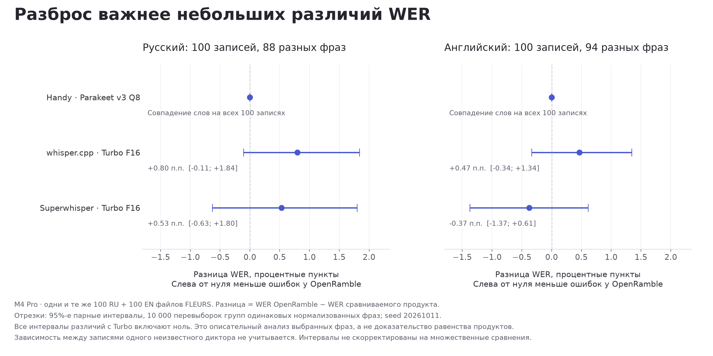
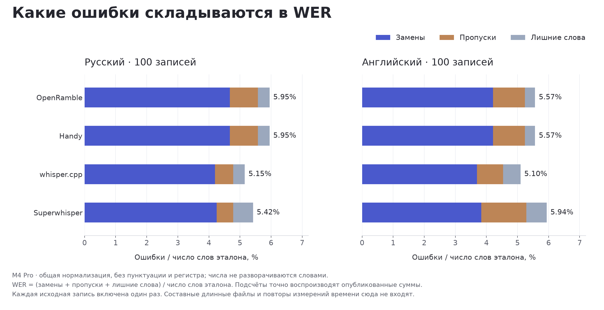

# OpenRamble on Mac Mini: latency, quality and memory

Baseline measured 9 October 2026; follow-ups on 11 October. Apple M4, 10 CPU cores, 16 GiB, macOS 26.4
(25E246). OpenRamble 0.32.0 source, transcribe.cpp 0.2.3, Parakeet v3
Q8 with Metal. This is an injected-controller and file-processing study.
It does not measure physical-key latency or pasting into another app.

## Findings

На четырёх фиксированных записях p50 ожидания после Stop составил 177–222 мс при обычной нагрузке и 165–212 мс при десяти занятых CPU-процессах. Диапазоны p95 по тем же записям: 190–246 мс и 199–260 мс соответственно. В каждой ячейке 20 повторов. Это контроллерный замер с подачей публичного аудио, без физической клавиши и вставки в стороннее приложение.

Две независимые модели сократили медианное время обработки трёх длинных файлов на 12,1–13,9%. Максимальный наблюдавшийся объём физической памяти процесса вырос с 0,95 до 1,74 ГиБ. Одна новая попытка с двумя моделями остановилась по предупреждению памяти. В основной серии четыре модели были остановлены ещё при загрузке. Полученный выигрыш не проходит условие внедрения без новых сбоев памяти. Дополнительная проверка 11 октября завершила 17 запусков: по одному с четырьмя моделями на язык и по два–три с одной и двумя. В ней две попытки остановлены по памяти и четыре из-за начала сборок. После закрытия простаивавших процессов с суммарным объёмом физической памяти около 1,59 ГиБ один запуск с двумя моделями завершился, но это не отменяет провала проверки устойчивости. Оставшиеся семь запусков отменены. Медианы на слайде относятся к полной ранней серии; дополнительная диагностика показана отдельно.

В 21 завершённом запуске обработки файлов итоговый текст и временные метки слов точно совпали с соответствующим контролем на одной модели. Во всех 18 экспериментальных запусках совпали также границы и тексты отдельных фрагментов. При этом смешанный файл сохранил WER 39,07% и 33,80% пропусков. Совпадение результатов подтверждает сохранение поведения при параллельной обработке, но не полноту распознавания. Во всех 17 завершённых запусках дополнительной серии также совпали текст, временные метки и фрагменты. Это отдельная проверка, её повторы не объединены с ранними.

В ветке исправлены границы после начальной тишины и обработка длинных импортов: предел 15 секунд и сохранение распознанных слов через временной разрыв. Качество проверено на новых фразах и через FileTranscriber. По умолчанию остаются одна модель, прежнее чтение диктовки и порог живого микрофона 0,02. Параллельные модели, чтение остатка и снижение общего порога не прошли заранее заданные условия. Отдельный порог 0,005 для системного звука прошёл проверки эха и вторую отложенную выборку; он внедрён в ветке. Изменения находятся в PR и ещё не выпущены.

## Stop to text

| Input | Condition | n | Stop p50, ms | p95, ms | max, ms | WER | Deletions | Completed before Stop |
| --- | --- | --- | --- | --- | --- | --- | --- | --- |
| en-60s | 10 CPU-busy processes | 20 | 211.6 | 260.0 | 278.8 | 11.81% | 6.30% | [2] |
| en-60s | normal desktop | 20 | 221.3 | 240.6 | 247.6 | 11.81% | 6.30% | [2] |
| en-short | 10 CPU-busy processes | 20 | 183.5 | 222.4 | 461.5 | 0.00% | 0.00% | [0] |
| en-short | normal desktop | 20 | 177.4 | 190.4 | 191.1 | 0.00% | 0.00% | [0] |
| ru-60s | 10 CPU-busy processes | 20 | 165.0 | 198.9 | 218.7 | 1.80% | 1.80% | [3] |
| ru-60s | normal desktop | 20 | 182.9 | 203.1 | 205.4 | 1.80% | 1.80% | [3] |
| ru-short | 10 CPU-busy processes | 20 | 208.9 | 252.5 | 277.2 | 0.00% | 0.00% | [0] |
| ru-short | normal desktop | 20 | 221.9 | 246.2 | 267.5 | 0.00% | 0.00% | [0] |

The timer starts immediately before `DictationController.stop()` and ends
at entry to the test insertion sink. It includes unfinished streamed work,
the tail, joining and normal controller text processing. Prerecorded PCM is
fed to the shipping SpeechSegmenter at the original 16 kHz pace. The actual
microphone and OS insertion boundary are replaced. The installed desktop
app was 0.31.2 and remained idle; it is not the tested binary.

These are four fixed public inputs. Twenty timing repetitions per cell
do not provide twenty independent speech examples. WER and deletions are
medians across repetitions; the machine-readable summary includes ranges
and the number of distinct outputs. Short inputs have no completed prefix,
so their complete recognition happens after Stop. The longer inputs can
finish prefixes during capture.

## Initial independent-model series on long files

| Input | Models | n | p50, s | min–max, s | RSS peak, GiB | Sampled footprint, GiB | WER | Deletions |
| --- | --- | --- | --- | --- | --- | --- | --- | --- |
| en-3540s | 1 | 3 | 68.92 | 68.81–69.08 | 0.93 | 0.94 | 9.76% | 4.80% |
| en-3540s | 2 | 3 | 60.56 | 60.50–60.62 | 1.73 | 1.73 | 9.76% | 4.80% |
| mixed-3540s | 1 | 3 | 67.10 | 67.09–67.52 | 0.92 | 0.93 | 39.07% | 33.80% |
| mixed-3540s | 2 | 3 | 58.29 | 58.08–58.52 | 1.74 | 1.74 | 39.07% | 33.80% |
| ru-3540s | 1 | 3 | 70.71 | 70.50–72.17 | 0.95 | 0.95 | 6.49% | 1.71% |
| ru-3540s | 2 | 3 | 60.84 | 60.62–61.02 | 1.73 | 1.73 | 6.49% | 1.71% |

Four models had no file-time result in this initial series. The first four-model smoke attempt
triggered memory pressure level 2 during preparation at a sampled physical
footprint of 2,682,194,464 bytes. The incomplete morning pilot also includes
one-model memory warnings and four successful RU/EN timings; none of those
timings are pooled with this primary series.

At the user's request, resources were freed before a new series. Two earlier
simulators were already stopped, and the remaining idle simulator was shut
down by its exact ID after checking for active tests. Swap use had fallen
from about 12 GiB to 3.4 GiB before that shutdown, and pressure was normal.
A newly registered four-model smoke still warned during loading at a sampled
footprint of 3,385,740,384 bytes. It was terminated before recognition. These
are controlled pressure aborts on this shared 16 GiB desktop, not runtime
OOM results or a universal model-count limit. Failures remain in the data;
failed durations are not part of successful-run percentiles.

The new file series also had a memory-pressure interruption on the third
two-model English pass, after fifteen successful complete files. Before
resuming that pass, idle Chrome, Brave, Claude, Telegram and the Simulator
application were closed through their normal quit operation, as authorized
by the user. Successful repetitions straddle that recorded resource change;
they do not prove that two models are safe under every desktop workload.

During the real-time controller series, after 45 complete runs, a sequence
of external compilations and newly booted QA simulators interrupted and
delayed the next minute-long input. The observed simulators were shut down,
and the specific UI-test build that restarted one was cancelled under the
user's resource authorization. Pressure returned to normal and the same job
was resumed. Interrupted attempts contribute no latency result. These are
recorded condition events on the shared desktop, not inference failures.

All recorded interruptions, including the earlier pilot and smoke checks:

| Series | Attempt | Stop reason | Last sample, s | Peak sampled footprint, GiB |
| --- | --- | --- | --- | --- |
| files-v2 | file-ru-3540s-settled-1-normal-0 | memory pressure | 1.11 | 0.89 |
| files-v2 | file-mixed-3540s-settled-1-normal-0 | memory pressure | 8.51 | 0.91 |
| files-v2 | file-mixed-3540s-settled-1-normal-0 | memory pressure | 1.11 | 0.89 |
| smoke-v1 | file-en-60s-settled-4-normal-0 | memory pressure | 1.10 | 2.50 |
| smoke-v3 | file-en-60s-settled-4-normal-0 | memory pressure | 1.06 | 3.15 |
| files-v3 | file-en-3540s-settled-2-normal-2 | memory pressure | 17.77 | 1.74 |
| controller-v1 | controller-ru-60s-realtime-1-normal-5 | build started during measurement | 37.72 | 0.89 |
| controller-v1 | controller-ru-60s-realtime-1-normal-5 | build started during measurement | 2.21 | 0.88 |
| controller-v1 | controller-ru-60s-realtime-1-normal-5 | memory pressure | 59.40 | 0.91 |
| controller-v1 | controller-ru-60s-realtime-1-normal-5 | build started during measurement | 4.15 | 0.88 |
| controller-v1 | controller-en-60s-realtime-1-normal-5 | build started during measurement | 61.60 | 0.91 |
| controller-v1 | controller-en-60s-realtime-1-normal-5 | memory pressure | 45.37 | 0.88 |
| files-v4 | file-ru-3540s-settled-4-normal-1 | memory pressure | 9.43 | 3.29 |
| files-v4 | file-ru-3540s-settled-2-normal-2 | memory pressure | 64.50 | 1.73 |
| files-v4 | file-ru-3540s-settled-2-normal-2 | build started during measurement | 3.17 | 1.69 |
| files-v4 | file-en-3540s-settled-1-normal-2 | build started during measurement | 3.11 | 0.91 |
| files-v4 | file-en-3540s-settled-1-normal-2 | build started during measurement | 35.07 | 0.93 |
| files-v4 | file-en-3540s-settled-1-normal-2 | build started during measurement | 23.65 | 0.94 |

The last sample is time since process launch, not successful processing time.
Failed attempts are retained separately from successful-run percentiles.

One-model shipping FileTranscriber controls (one pass each):

| Input | Time, s | WER | Deletions |
| --- | --- | --- | --- |
| en-3540s | 69.41 | 9.76% | 4.80% |
| mixed-3540s | 67.66 | 39.07% | 33.80% |
| ru-3540s | 71.21 | 6.49% | 1.71% |

The experiment keeps FileAudioChunks boundaries and TimedTranscriptJoiner.
Each model owns an independent serialized runtime queue. Results from a
bounded wave are sorted into original order before joining. The experimental
one-model path does not prefetch; the shipping control retains its one-chunk
prefetch. The parity audit compares complete text, all word timings, every
chunk boundary and every chunk text hash against the one-model baseline.

Quality is measured independently of speed. A file that finishes with omitted
speech has not established a useful performance gain. Input recordings are
whole public FLEURS phrases separated by 0.5 seconds of silence and repeated
to approximately 59 minutes. They are not natural conversations or meetings.

## Separate scaling requalification on 11 October

After the baseline, the host had normal memory pressure and a 65% free-memory query. No build or XCTest process was active. The same frozen source, binary, model and inputs passed all 10 smoke checks, including exact text and word-time parity for 1/2/4 models. A new 30-job file matrix followed. Three four-model files completed, then the second RU four-model attempt warned at 9.43 s process age and 3,534,081,456 bytes sampled footprint. The remaining four-model repetitions were cancelled; supported 1/2-model and shipping jobs continued. The final diagnostic has 17 successes: three RU and two EN/mixed repetitions for 1/2 models, plus one four-model pass per language. The remaining seven supported jobs were cancelled after further compiler interruptions and sustained preflight memory pressure. This closes the failed scheduling hypothesis; it is not a completed timing matrix. No timing is pooled with the earlier series, and the four-model observations are not repeatability estimates.

A later two-model RU attempt also reached pressure level 2 after 64.50 s, at a sampled footprint of 1,855,244,424 bytes. Two long-idle CLI trees and their helpers were then terminated. Their combined sampled physical footprint was about 1.59 GiB; this is not a measurement of the exact amount of system RAM reclaimed. No files were deleted. The first resumed attempt was interrupted by an unrelated compiler. Successful timings therefore span an explicit resource-condition change; the full ranges and all failed attempts are retained. Neither two nor four models passed the no-new-memory-warning adoption gate.

| Input | Path | Models | n | p50, s | min–max, s | Sampled footprint, GiB | WER | Deletions |
| --- | --- | --- | --- | --- | --- | --- | --- | --- |
| en-3540s | file | 1 | 2 | 74.25 | 65.40–83.10 | 0.94 | 9.76% | 4.80% |
| en-3540s | file | 2 | 2 | 65.90 | 57.54–74.26 | 1.73 | 9.76% | 4.80% |
| en-3540s | file | 4 | 1 | 51.82 | 51.82–51.82 | 3.33 | 9.76% | 4.80% |
| mixed-3540s | file | 1 | 2 | 72.91 | 64.33–81.48 | 0.93 | 39.07% | 33.80% |
| mixed-3540s | file | 2 | 2 | 63.38 | 56.65–70.11 | 1.74 | 39.07% | 33.80% |
| mixed-3540s | file | 4 | 1 | 50.07 | 50.07–50.07 | 3.33 | 39.07% | 33.80% |
| ru-3540s | file | 1 | 3 | 86.64 | 66.94–90.90 | 0.95 | 6.49% | 1.71% |
| ru-3540s | file | 2 | 3 | 58.25 | 58.17–59.13 | 1.74 | 6.49% | 1.71% |
| ru-3540s | file | 4 | 1 | 52.57 | 52.57–52.57 | 3.32 | 6.49% | 1.71% |

The primary scaling bars retain the complete earlier 21-job cohort. The separate chronological figure displays this diagnostic and its interruptions. Earlier warnings remain part of the resource evidence. See [scaling data](data/scaling/summary.json).

## Meeting and queue diagnostics

| Input | Path | Pacing | Condition | n | Stop p50, ms | p95, ms | WER | Deletions |
| --- | --- | --- | --- | --- | --- | --- | --- | --- |
| en-360s | controller | burst | 10 CPU-busy processes | 5 | 6177.7 | 6326.6 | 6.85% | 2.41% |
| en-360s | controller | burst | normal desktop | 5 | 5753.8 | 5771.0 | 6.85% | 2.41% |
| en-360s | controller | settled | 10 CPU-busy processes | 5 | 465.3 | 519.5 | 6.85% | 2.41% |
| en-360s | controller | settled | normal desktop | 5 | 435.2 | 441.7 | 6.85% | 2.41% |
| ru-360s | controller | burst | 10 CPU-busy processes | 5 | 6564.9 | 6644.4 | 7.28% | 1.69% |
| ru-360s | controller | burst | normal desktop | 5 | 5937.8 | 5951.2 | 7.28% | 1.69% |
| ru-360s | controller | settled | 10 CPU-busy processes | 5 | 348.3 | 354.7 | 7.28% | 1.69% |
| ru-360s | controller | settled | normal desktop | 5 | 320.3 | 323.4 | 7.28% | 1.69% |
| en-60s | meeting | settled | 10 CPU-busy processes | 20 | 0.0 | 4.0 | 65.35% | 65.35% |
| en-60s | meeting | settled | normal desktop | 20 | 0.0 | 0.0 | 65.35% | 65.35% |
| ru-60s | meeting | settled | 10 CPU-busy processes | 20 | 123.5 | 147.7 | 6.31% | 5.41% |
| ru-60s | meeting | settled | normal desktop | 20 | 107.4 | 110.8 | 6.31% | 5.41% |

The EN minute meeting input lost 65.35% of reference words. Its near-zero
Stop time reflects a run with only two completed segments and no tail decode;
it is not a useful-speed claim. The follow-up coverage diagnostic in
[hypotheses](FINDINGS.md) distinguishes unsubmitted audio from model errors.

`settled` submits the next material only after earlier recognition has drained.
It measures a tail with no outstanding queue. `burst` injects the complete
file immediately and intentionally creates a backlog. Neither is the primary
real-time result. The six-minute controller input exercises the file-backed
completion path. Meeting timing uses production MeetingSegmentPolicy and
MeetingTranscriptionQueue from final submission to queue drain. It excludes
audio-device teardown, screen/video encoding and MeetingStore persistence.

### Confirmed meeting offset correction

A leading-silence trim retained one second of audio but reset the segmenter's
relative counter to zero. The resulting pause cut could fall inside spoken
audio. A pure regression failed against the old source at frame 261600,
before the required frame 272000. Restoring the retained second to the counter
fixes that coordinate invariant without changing the 0.02 peak threshold.

| Input | Original WER | Fixed WER | Preserve-all WER | Unsubmitted audio, original → fixed, s |
| --- | --- | --- | --- | --- |
| ru-60s | 6.31% | 1.80% | 1.80% | 10.09 → 5.87 |
| en-60s | 65.35% | 65.35% | 8.66% | 39.26 → 38.26 |
| ru-360s | 21.49% | 18.78% | 8.63% | 96.47 → 76.00 |
| en-360s | 71.70% | 70.43% | 8.76% | 229.20 → 223.77 |

Eight old-policy and eight fixed-policy quality/coverage runs completed. The
preserve-all controls have exactly identical text hashes and segment intervals
across both binaries. Local model-independent package, Rust, FFI and conformance
checks passed. The correction improves these RU examples but leaves substantial
low-level speech loss, especially in English. It is not a solution to the
fixed activity threshold. Full audio coverage also does not imply correct words.

Preserve-all is an existing imported-audio option and remains disabled for live
capture. Enabling it globally would require separate silence, noise and echo
checks. One earlier fixed-policy run stopped for memory pressure; it remains
in the evidence. After another project's simulator QA finished, that idle
simulator was shut down and the same frozen run resumed at normal pressure.
These observations support quality/coverage localization, not a paired speed
claim across binaries or desktop conditions.

See [exact comparison](data/meeting-after/offset-comparison.json),
[original runs](data/meeting-before/summary.json) and
[fixed runs](data/meeting-after/summary.json).

## Registered file-quality map and validation

The completed exploratory map has 18 native runs: six segmentation settings,
three languages and two join rules applied to the same native words. The
unchanged replay exactly matches all 18 native word sequences and timestamps.
Allowing earlier pauses improves mixed WER but the best mixed score regresses
RU beyond the predeclared gate. The selected eligible policy uses a 15-second
cap, 15-second pause minimum, 2-second context and the frozen gap-preserving join.

The choice was sealed before extracting 50 new, distinct phrases per language.
Their identifiers, normalized references and actual PCM payload hashes do not
overlap development. Each language's 50 phrases repeat inside long composites;
three computational repetitions per cell do not create extra speech examples.
All 18 native runs completed with exact within-cell text, words and chunk
geometry. The fixed candidate passed the registered quality and memory gates.
No candidate was selected or retuned using these holdout outputs.

| Language | Control WER | Selected WER | Difference, pp | Control / 15s median time, s |
| --- | --- | --- | --- | --- |
| RU | 6.13% | 5.81% | -0.317 | 98.272 / 103.191 |
| EN | 8.12% | 7.99% | -0.138 | 97.218 / 102.290 |
| MIXED | 43.87% | 33.16% | -10.715 | 92.985 / 99.106 |

Quality uses the unchanged native words with the two fixed join rules replayed
offline. Repeated times compare 30-second and 15-second segmentation with the
unchanged native joiner in both. The shorter segmentation costs 5.00–6.58%
more median processing time; those repeated times are not an estimate of the
complete gap-preserving shipping path. One-pass full-path checks serve parity,
not a new speed comparison.

The selected policy is implemented on the PR branch. The native joiner matches all 36 frozen development/holdout word exports; three complete FileTranscriber runs also match selected text and word times exactly. The old-behavior reproduction fails before the change and passes after it. Model-independent lifecycle/package checks pass. This is not a production release or a full model-E2E pass.

The [hypothesis ledger](FINDINGS.md) records validation, tail-read and
quiet-speech decisions with their evidence. A development win alone is
not an adoption decision. The [full selection](data/file-quality/development-decision.json)
and [validation registration](data/file-quality/heldout-registration.json)
retain all alternatives and the locked gates.

The two-run synthetic final-context diagnostic is complete: 500 ms of appended
silence produced exactly the same wrong text as the original Samantha phrase,
with one decode and no streaming cuts. This fixed-padding remedy is rejected;
[the negative result](data/tts-end-context/decision.json) is not pooled into
public-speech WER or claimed as a speed measurement.

## Quiet system playback: a separate, validated change

Lowering both channels from 0.02 to 0.005 failed two sparse-echo tests and was
rejected. Keeping all audio also failed both original echo tests. Neither
change is adopted. The fixed threshold nevertheless passed all 18 registered
speech/noise inference tests: five synthetic negatives produced zero words,
although some required extra decode work. These small fixtures do not prove
the absence of hallucinations in every noise condition.

Before inspecting those inference outputs, we registered a conditional
system-only follow-up: keep the microphone and CrossTalkGate unchanged,
lower only tapped playback to 0.005, and preserve explicitly supplied capture
parameters. Two default-capture tests failed before the implementation; all
45 capture/echo checks passed afterwards, including loud independent microphone
speech and ordinary/sparse echo with and without leading silence.

Only then did we open the second sealed set of 50 new RU and 50 new EN phrases.
No phrase, recording ID or actual PCM hash overlaps the preceding 300 clips.
Each phrase occurs once in its 593.80-second RU or 555.34-second EN composite.
Four native runs used the system channel, with one pass per language and arm;
the candidate omitted the threshold override to exercise the new default.

| Language | Control WER | System-only WER | Difference, pp | Decode calls, before / after |
| --- | --- | --- | --- | --- |
| RU | 7.95% | 6.60% | -1.342 | 42 / 43 |
| EN | 62.38% | 28.14% | -34.241 | 22 / 37 |

Every preregistered gate passed: English improvement at least 10 percentage
points, no RU WER/deletion regression above 0.5 points, no EN deletion increase,
no memory warning, and no single decode over two seconds (maximum 0.882 s).
The system-only default is implemented on the PR branch; the microphone stays
at 0.02. This is not released and does not establish live-call end-to-end
quality. Residual English WER of 28.14% remains substantial.

[Native decision and identity](data/system-heldout/decision.json),
[capture and echo evidence](data/system-meeting/echo-decision.json),
[full model-independent checks](data/system-meeting/check-evidence.json),
[prospective registration](data/system-meeting/system-only-registration.json).

The registered hypothesis map is complete. Quiet real microphones, natural
code-switching conversations and remote-call codecs require new matching audio
before another independent claim; retuning these inspected holdouts would
not provide that validation.

## Conditions and limitations

* Model loading and a five-second warmup precede each timed measurement.
  Loading has its own field in the data. Memory accounting includes loading.
* Ten owned Python CPU-busy processes create the pressure condition. Their
  identities are retained privately and they are stopped after every run.
* The Mini is a shared active desktop. Process, thermal, swap and memory
  snapshots are kept around every run. The runner waits for builds and normal
  memory pressure before a job, and aborts if a build begins or pressure rises.
  Full process paths remain private; sanitized system values are published.
* Peak RSS comes from Darwin getrusage. Physical footprint is sampled through
  proc_pid_rusage once per second and can miss short peaks. It is not a precise
  energy or GPU-allocation measurement.
* WER is substitutions plus deletions plus insertions divided by reference
  words. Normalize NFC, lowercase, replace ё by е and retain Unicode word
  tokens. Do not expand numerals. Percentiles interpolate at `(n-1)*p`.
* The p95 estimate uses only 20 observations per cell and is sensitive to the
  largest observations. The file experiment reports min/max, not a stable
  tail percentile from three repetitions.

## Earlier M4 Pro evidence stays separate

The [earlier study](../product-benchmark-2026-10/README.md) compared 200 public
files and complete CLI process times on M4 Pro, 14 CPU cores, 24 GB. Those
numbers must not be merged into the Mini series or called key-release latency.
The mixed-language long-file result there was WER 39.07% with deletions 33.80%.
Handy/Parakeet hit Metal OOM on all 12 hour-long attempts. Both negatives remain
part of the evidence.

### Uncertainty on the original short-file quality comparison

The published error counts and WER reproduce exactly from all 200 original
outputs. There are 88 distinct normalized reference phrases among the 100 RU
recordings, and 94 among the 100 EN recordings. The analysis resamples these
phrase clusters with replacement 10,000 times, separately by language, using
seed 20261011. Each sampled cluster retains all its recordings; every product
uses the same draw. WER is the ratio of summed errors to summed reference words,
not the mean of per-recording WERs.

| Language | Comparator | WER difference, pp | Paired 95% interval, pp | OpenRamble fewer / equal / more errors, files |
| --- | --- | --- | --- | --- |
| RU | handy | +0.00 | +0.00 to +0.00 | 0 / 100 / 0 |
| RU | whisper | +0.80 | -0.11 to +1.84 | 14 / 65 / 21 |
| RU | superwhisper_turbo | +0.53 | -0.63 to +1.80 | 18 / 62 / 20 |
| EN | handy | +0.00 | +0.00 to +0.00 | 0 / 100 / 0 |
| EN | whisper | +0.47 | -0.34 to +1.34 | 12 / 69 / 19 |
| EN | superwhisper_turbo | -0.37 | -1.37 to +0.61 | 22 / 62 / 16 |

Differences are OpenRamble minus comparator: negative means fewer errors for
OpenRamble. All four intervals against the Turbo configurations include zero.
These descriptive intervals do not establish an accuracy winner, equivalence,
or performance on other speech populations. The procedure handles repeated
reference text but cannot account for unknown speaker dependence. Intervals
are unadjusted for multiple comparisons and this analysis was registered after
the aggregate estimates were already known. Timing repeats and long composites
are excluded. The OpenRamble/Handy identity is an observed 200/200 normalized
transcript match, not a general statement about all product configurations.

See [method and results](data/quality-uncertainty/quality-uncertainty.json) and
[per-recording counts](data/quality-uncertainty/quality-per-file.jsonl).

## Evidence and reproduction

See [protocol](PROTOCOL.md), [commands](REPRODUCIBILITY.md),
[chart references](CHART_SOURCES.md), and [summary](data/summary.json).
The compressed public runs include complete recognized text, chunk text,
word timestamps and hashes. The fixture manifest includes reference text,
source phrase identities and hashes. Audio/model binaries and private
correspondence are not included in this review package or public results.

FLEURS is CC BY 4.0, pinned to revision
`70bb2e84b976b7e960aa89f1c648e09c59f894dd`. Model SHA-256:
`5859f77944efcd8eafa23a6350731960b2b55b2203df51f319665c807d802cc7`.

The chart layout was informed by the actual figures in
[Anthropic's Sonnet 5 release](https://www.anthropic.com/news/claude-sonnet-5)
and [OpenAI's GPT-5.4 mini/nano release](https://openai.com/index/introducing-gpt-5-4-mini-and-nano/).
Units, shared scales, explicit timing boundaries and adjacent methodology
captions are reused as presentation principles; vendor benchmark scores are
not part of the OpenRamble comparison.
